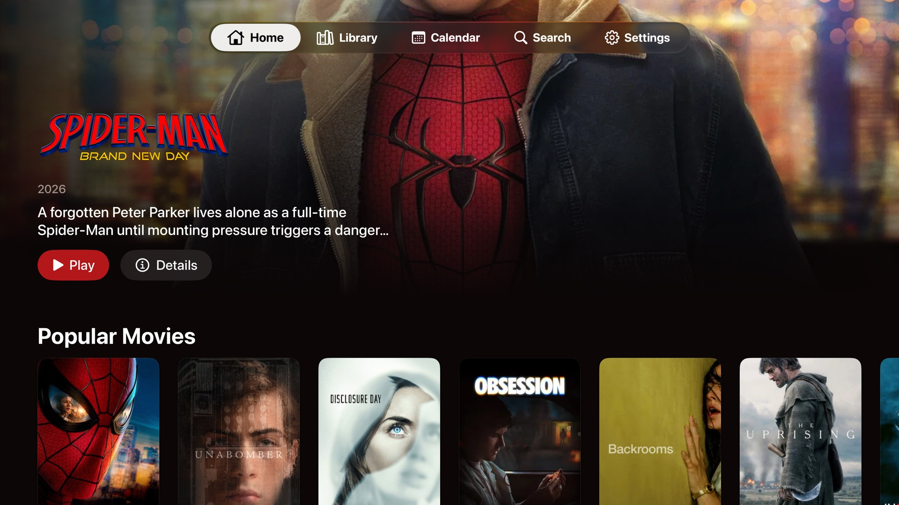
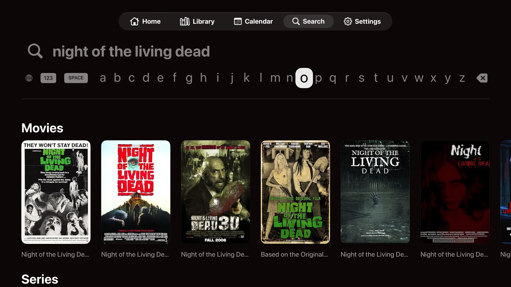
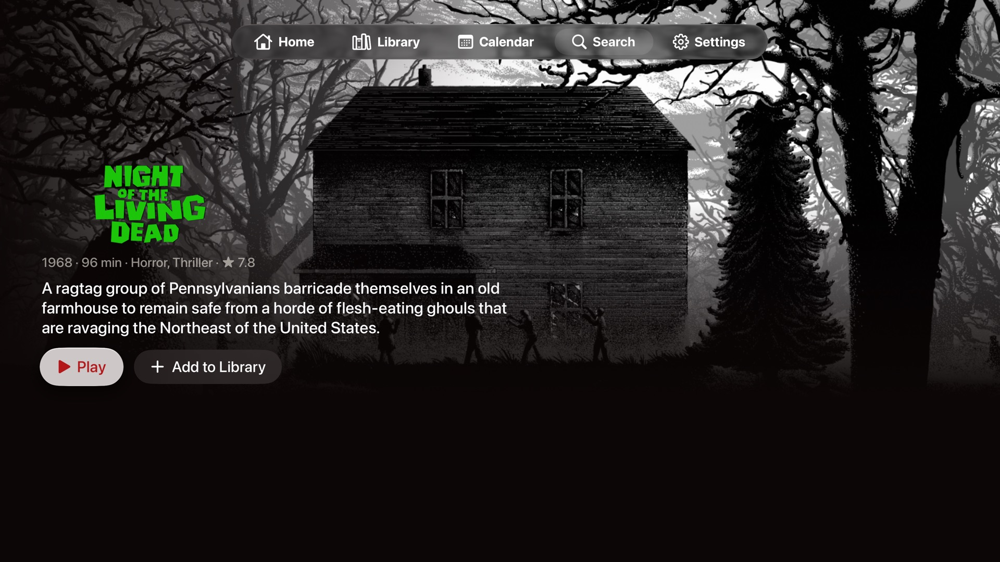
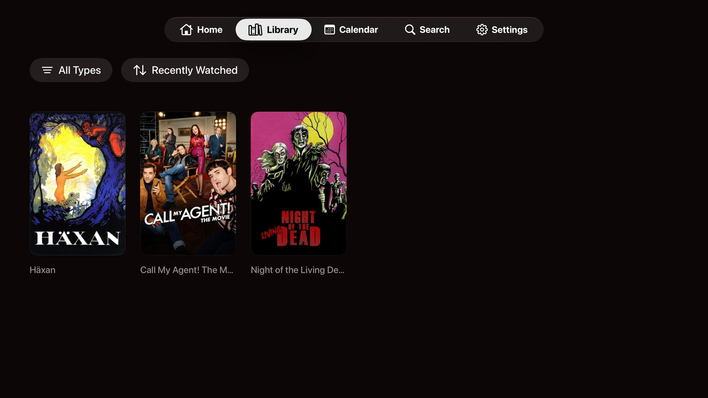
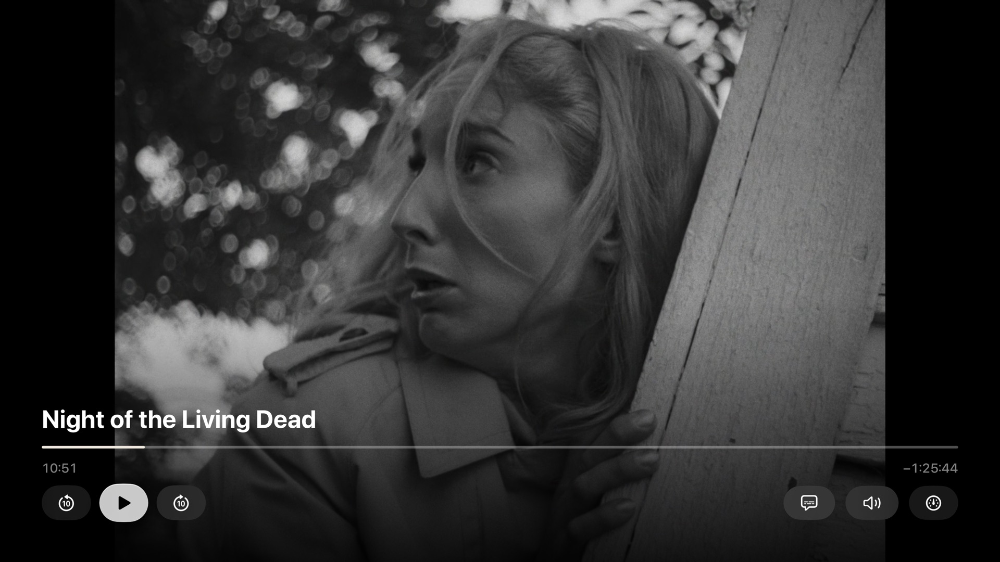
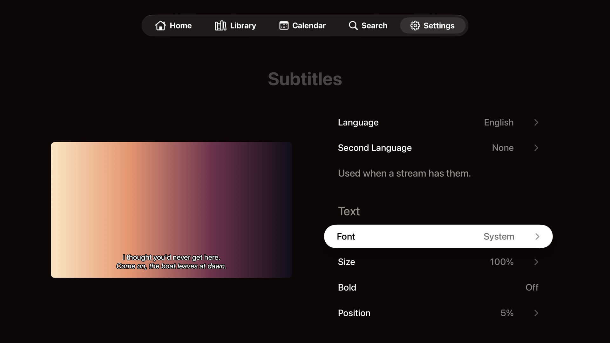

# Takane

Takane is a Stremio client for Apple TV. It follows Apple's tvOS design, plays with Dolby Vision and Dolby Atmos where your setup supports them, and runs on your own Stremio account and add-ons.

## Install

Takane is not on the App Store. You install it yourself, a process called sideloading.

1. Download `Takane.ipa` from the latest [GitHub release](https://github.com/szymonograbek/takane/releases/latest).
2. Sign and install it on your Apple TV with a sideloading tool that supports tvOS, or with Xcode on a Mac. The tool signs the app with your Apple ID.
3. Open Takane and sign in with your Stremio account, or continue without one.

With a free Apple ID, the signature expires after 7 days and you sideload again. A paid Apple Developer account extends it to a year. Your library and settings live in your Stremio account, so reinstalling loses nothing.

Takane needs tvOS 18 or later.

## Other devices

Apple TV is the platform Takane is built for.

- On a Mac, iPhone or iPad, use the official [Stremio app](https://www.stremio.com/downloads).
- Android and Android TV are not supported, and there are no plans to support them for now.

## What you can do

Takane shows what your add-ons provide. Catalogs, titles, artwork and streams all come from the add-ons installed on your Stremio account, so your setup looks the same here as in any other Stremio app.

**Sign in your way.** Scan a QR code with your phone, or type your email and password. You can also continue without an account.

**Home.** A featured title, Continue Watching with how much time is left, and a row for every catalog your add-ons offer.

**Search.** Search every add-on at once. Before you type, Search shows your recent searches and genres for movies and series.

**Details.** Description, genres, IMDb rating and episodes by season. Resume where you stopped, mark titles and episodes as watched, or add them to your library. Hide Spoilers blurs the stills and descriptions of episodes you have not watched.

**Streams.** Play lists the playable streams from all of your add-ons.

**Library.** Everything you saved, filtered by type and sorted by recently watched, name or unwatched first.

**Calendar.** Upcoming episodes of the shows in your library, grouped by day.

**Player.** The player works like Apple's own. Press the remote to show the controls, skip back and forward, scrub the timeline, and pick subtitles, audio and speed. Takane remembers your track choices for each title.

- **Skip Intro** for episodes with known intro, recap and credits times.
- **Up Next** offers the next episode before the current one ends and can play it automatically.
- **Subtitles** from the stream itself or from subtitle add-ons, in the style you choose: size, font, colors, outline, background and position. Takane can keep a file's own styling instead.
- **Audio** in your preferred language, with a second language as a fallback.

**Settings.** Manage your account, install and remove add-ons, and set playback and subtitle preferences. Settings sync to your Stremio account, so they follow you to other Stremio apps.

## What the player supports

Takane plays through [AetherEngine](https://github.com/superuser404notfound/AetherEngine). Apple TV hardware decodes the video and handles HDR and Atmos output.

| | Supported |
|---|---|
| Containers | MKV, MP4, WebM, MPEG-TS, AVI, WMV, OGG, FLV |
| Video, hardware decoding | H.264, HEVC (including 10-bit), AV1 on Apple TVs with AV1 hardware |
| Video, software decoding | AV1, VP9, VP8, MPEG-2, MPEG-4 Part 2, VC-1 |
| HDR | HDR10, HDR10+, HLG |
| Dolby Vision | Profiles 5, 8.1, 8.4 and AV1 profile 10. Profile 7 plays as 8.1, without the enhancement layer. |
| Dolby Atmos | Dolby Digital Plus (E-AC-3) Atmos passes through to your receiver or soundbar. |
| Audio passed through as is | AAC, Dolby Digital (AC-3), Dolby Digital Plus (E-AC-3), FLAC, ALAC |
| Audio converted to Dolby Digital Plus 5.1 | Dolby TrueHD, DTS, DTS-HD MA, Opus, Vorbis, MP3, PCM and others. TrueHD Atmos and DTS:X play without their height channels. |
| Subtitles | SRT, ASS/SSA, WebVTT and MP4 text; PGS, DVB and DVD image subtitles |
| Display | Follows your Apple TV's Match Dynamic Range and Match Frame Rate settings |

Takane plays HTTP streams, such as those from debrid add-ons. It does not play torrents, because it does not include Stremio's streaming server.

## Privacy

Takane has no server of its own and collects no analytics. It talks only to:

- Stremio, to sign in and sync your library, progress and settings.
- The add-ons you installed, for catalogs, titles, streams and subtitles.
- [SkipDB](https://skipdb.tv), which receives the IMDb id of what you play (and the season and episode) to find intro and credits times.

Your account, add-ons and history stay with Stremio, the same as in Stremio's own apps.

## Contributing

To build Takane from source, see [DEVELOPERS.md](DEVELOPERS.md). Changes are listed in [CHANGELOG.md](CHANGELOG.md).
